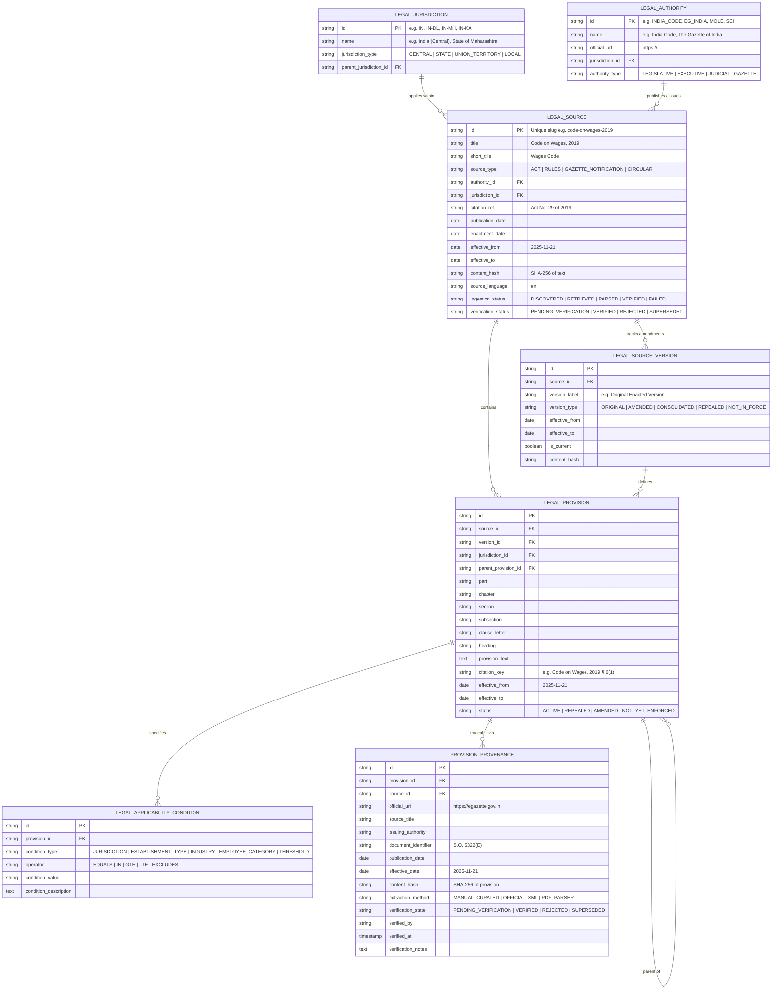

# ClauseTrace — Indian Legal Knowledge Foundation Architecture (Iteration 2A & 2A.1)

## 1. Overview & Objectives

ClauseTrace is an evidence-grounded legal intelligence system specializing in the Indian corporate and employment ecosystem. 

Iteration 2A & 2A.1 establish an auditable, normalized, and jurisdiction-aware **Legal Knowledge Subsystem**. It decouples private user contracts and policies from official legal authorities, enabling statutory compliance checks against:

- Central Acts and Codes (e.g. Code on Wages, 2019; Industrial Relations Code, 2020; Code on Social Security, 2020; OSHWC Code, 2020).
- Official Gazette commencement notifications and section-level appointed dates.
- Subordinate Central and State Rules (e.g. draft/final rules notified by Central Government and states like Karnataka/Maharashtra).
- Section/subsection/clause hierarchies with explicit temporal and geographical scope.

---

## 2. Statutory Commencement & Gazette Ground Truth

Pursuant to official Central Government Gazette Notifications published on **21 November 2025** (reference: Press Information Bureau release **PIB PRID 2192463**), the four central Labour Codes were appointed to come into force on **21 November 2025**:

1. **Code on Wages, 2019 (Act No. 29 of 2019):**  
   Commenced via **S.O. 5322(E)** dated 21 November 2025.  
   - *Sections Commenced:* Sections 1 to 41, 42(4) to 42(9), 43 to 66, 67(1), 67(2)(a)-(r), (u)-(zc), 67(3)-(5), 68, 69.
   - *Provision-Level Exception:* Section 42(1) to 42(3) (Central and State Advisory Board constitution) were withheld from enforcement and marked `NOT_YET_ENFORCED`.
2. **Industrial Relations Code, 2020 (Act No. 35 of 2020):**  
   Commenced via **S.O. 5320(E)** dated 21 November 2025.
3. **Code on Social Security, 2020 (Act No. 36 of 2020):**  
   Commenced via **S.O. 5319(E)** dated 21 November 2025.
4. **Occupational Safety, Health and Working Conditions Code, 2020 (Act No. 37 of 2020):**  
   Commenced via **S.O. 5321(E)** dated 21 November 2025.

### Distinct Statutory Layers:
- **Act Commencement vs Subordinate Rules:** While the statutory provisions took effect on 2025-11-21, administrative rules notification occurs in separate tranches (Central Rules and State-level Rules published by individual state labor departments). The metadata schema explicitly tracks `rules_notification_status` and `state_rules_status` independently from Act `effective_from`.
- **Provision-Level Granularity:** Statutes do not always commence in full. ClauseTrace models status at the individual provision level (`ACTIVE`, `NOT_YET_ENFORCED`, `AMENDED`, `REPEALED`).

---

## 3. Entity Relationship Diagram (ERD)

---

## 4. Provenance & Scoped Verification Security

1. **Zero Auto-Verification:**  
   Every legal provision entering the system—regardless of whether parsed via PDF, text extraction, or manual curation—is strictly initialized with status `PENDING_VERIFICATION`. A parser success does **not** equal legal verification.
2. **Scoped Auditor Authorization:**  
   Updates to statutory verification status (`PATCH /api/v1/legal/provisions/{id}/verification`) are guarded by the `X-Auditor-Key` header checked against `AUDITOR_API_KEY`. Unauthenticated or unauthorized callers receive `403 Forbidden`.
   > [!NOTE]
   > **Security Limitation Notice:** The auditor header provides scoped token authorization for Administrative/Auditor API interactions. Full enterprise multi-tenant RBAC or OAuth2 session management will be added when user account identity workflows are introduced in future platform iterations.
3. **Immutable Content Hashing:**  
   Both legal source raw instruments and individual statutory provisions are hashed via SHA-256 (`content_hash`). If text alters, the hash mismatches and flags integrity violations.
4. **Historical Preservation:**  
   When amendments or consolidated revisions are introduced, historical versions are preserved with `effective_from` and `effective_to` dates. Historical records are never overwritten.

---

## 5. REST API Endpoints

Mounted under prefix `/api/v1/legal`:

| Method | Endpoint | Authorization | Description |
| :--- | :--- | :--- | :--- |
| `GET` | `/jurisdictions` | Public | List all supported central and state jurisdictions. |
| `GET` | `/authorities` | Public | List trusted official sources (India Code, e-Gazette, MOLE, Supreme Court). |
| `POST` | `/sources` | Public | Register a new authoritative legal instrument. |
| `GET` | `/sources` | Public | List legal sources filtered by jurisdiction, type, or verification status. |
| `GET` | `/sources/{id}` | Public | Get full source details and version history. |
| `POST` | `/sources/{id}/versions` | Public | Register an amendment or consolidated version. |
| `POST` | `/sources/{id}/provisions` | Public | Ingest structured legal provisions with provenance attached. |
| `GET` | `/sources/{id}/provisions` | Public | List provisions under a specific source and version. |
| `GET` | `/provisions/{id}` | Public | Retrieve provision details with provenance and applicability conditions. |
| `POST` | `/provisions/search` | Public | Search provisions with structured filters (jurisdiction, effective date, query text). |
| `GET` | `/provisions/{id}/provenance` | Public | Retrieve official URI, issuing authority, and verification state. |
| `PATCH` | `/provisions/{id}/verification` | `X-Auditor-Key` | Update verification status (audited transition to `VERIFIED` or `REJECTED`). |
| `POST` | `/corpus/seed-initial-codes` | Public | Initialize initial corpus for the 4 central Labour Codes. |

---

## 6. PostgreSQL Migration Assessment & Operational Status

- **Current Runtime Persistence:**  
  The application runtime operates strictly on SQLite with Write-Ahead Logging (`journal_mode=WAL; PRAGMA foreign_keys=ON;`) located at `data/clausetrace.db`.
- **PostgreSQL Readiness (Schema DDL Level):**  
  All 7 legal knowledge foundation tables are prepared for PostgreSQL 16+ with complete ANSI DDL at:  
  `backend/app/db/migrations/pg_legal_knowledge_v1.sql`.
- **Operational Reality:**  
  PostgreSQL is **not** currently wired into the runtime `app/db/database.py` connection factory. The SQLite engine is the single active runtime store. When deploying against external PostgreSQL, configuring `DATABASE_URL` and switching the connection pool in `database.py` will activate the PostgreSQL tables without requiring table schema redesigns.
